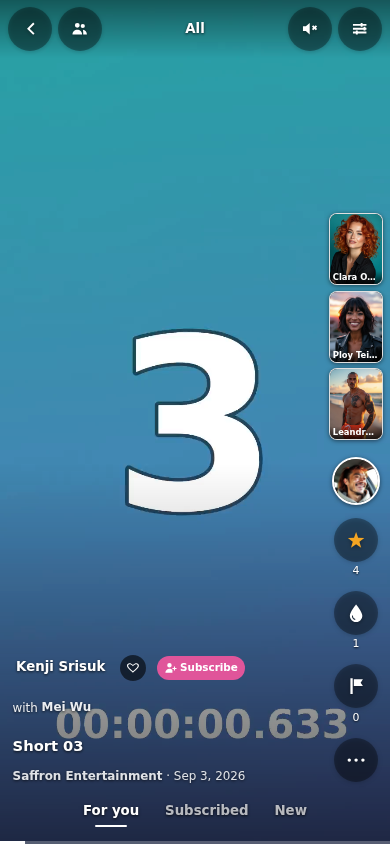
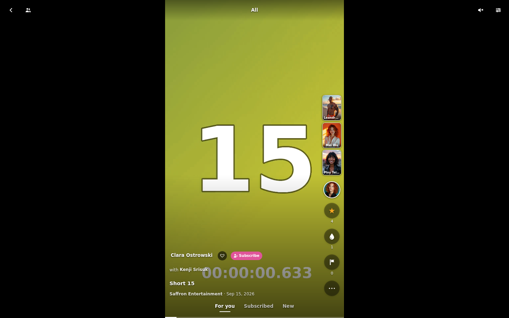

# Stash Shorts

[](https://github.com/stashapp/stash)
[](CHANGELOG.md)
[](LICENSE)

A [Stash](https://github.com/stashapp/stash) UI plugin that turns your portrait scenes into a full-screen
feed: one video per screen, swipe up for the next one. Works on the phone and on the desktop, where the
video sits in a portrait column in the middle.

| Phone | Desktop |
|---|---|
|  |  |

| Creator profile | Detail sheet | Session summary |
|---|---|---|
|  |  |  |

The screenshots show an invented library and generated test clips: made-up names and studios,
AI-generated faces, numbered colour gradients. No real people and no real data.

## Installation

### From the plugin source (recommended)

In Stash: Settings → Plugins → Available Plugins → Add Source, with the URL

```
https://max-dev42.github.io/stash-plugins/index.yml
```

then install **Stash Shorts** from that source. Stash shows updates there.

### By hand

Copy the `plugin/` folder into Stash's plugins directory under the name `stash-shorts` (the folder name
and `stash-shorts.yml` must match), then reload plugins (Settings → Plugins → Reload plugins).

```
<stash config>/plugins/stash-shorts/
  stash-shorts.yml
  stash-shorts-core.js
  stash-shorts.js
  stash-shorts.css
  locales/
```

The page is at `/shorts`; the navbar gets a "Shorts" entry.

## Features

**The feed**

- Portrait scenes only (Stash's orientation filter), so the feed looks like shorts. Landscape scenes
  only when you turn them on, then across the full width with the picture blurred around them; turn the
  phone and they fill the screen.
- Swipe, mouse wheel or arrow keys for the next and previous scene; the feed snaps to one scene.
- Modes at the bottom: For you, Subscribed (performers you subscribe to, newest first) and New
  (unwatched, newest first by date).
- Scene markers as clips of their own, from the marker's time, with its title and tag.
- Galleries as posts: flip their pictures sideways, rate the gallery, count an orgasm on a picture.
- Videos start muted; a tap turns the sound on for the rest of the session. Clips loop, or move on to
  the next one at the end (setting); hold to pause, tap the progress bar to jump.

**Performers**

- Profile button at the top of the column: the main performer's picture opens their profile. The caption
  names them with favorite heart and Subscribe (kept apart from Stash's favorite); the title unfolds to
  the post text.
- Performer channel: swipe to the left (or tap a name after "with") to stay with a performer of the current scene,
  only their scenes from there on; swipe to the right to go back to where you were.
- Creator profile: banner, avatar, handle, Subscribe, links as on Stash's performer page, bio and numbers; posts (scenes and galleries by
  date), a media grid and favorites; a post plays in the performer's channel.
- Side previews: up to three related performers next to the video; performer bar at the top with
  favorites first. A tap opens their channel.

**Actions**

- Rating with stars, orgasm counter with a splash of white drops and Undo, double tap to add an orgasm.
- Detail sheet over the playing video: markers (a tap jumps there), details and links, tags (a tap
  filters the feed), people.
- More: share a link to the scene or gallery, open the scene or a performer in Stash, the filters.
- Quick actions (setting): a row with rating, orgasm and up to five tags to toggle with one tap.
- Counts as watched after a few seconds, like Stash's own player (adjustable, can be turned off).
- Session summary when leaving: time, clips watched, orgasms, new subscriptions; the last ten in More.

**Order and filters**

- "For you" order, computed in the browser from your ratings, orgasm counts, plays and favorites, with
  a random share; or random, newest by date, newest in Stash or most viewed. Nothing is sent anywhere.
- Filters by tags, studios, performers, favorite and subscribed performers, rating and unwatched scenes.
  The dialog suggests only what has scenes in the feed, with their number.
- Continues where you were, per filter and channel (kept in the browser), with "Start over".

**Under the hood**

- On the phone's home screen like an app, starting at the Shorts page ([docs/home-screen.md](docs/home-screen.md)).
- Light on the browser: at most three video elements, slides further away are not in the page; gallery
  pictures and previews are images.
- Plays straight from Stash; no server component, no request leaves the Stash origin.
- English, German, French, Spanish, Italian, following the Stash interface language.

## Controls

| | Phone | Desktop |
|---|---|---|
| Next / previous | swipe up / down | mouse wheel, ↓ / ↑, j / k, Page Down / Up |
| Performer channel | swipe left | →, drag left |
| Gallery: next / previous picture | swipe left / right | → / ←, drag |
| Profile | tap the picture at the top of the column, or the name | click the picture or the name |
| Orgasm | double tap the video, drop button (hold it to take one back) | drop button |
| Back from the channel | swipe right, back button of the browser | ←, drag right, back button of the browser |
| Sound on / off | tap the video | tap the video, `m`, speaker button |
| Pause | hold the video | space |
| Jump | tap the progress bar | click the progress bar |
| Leave (summary first) | back button | back button, Esc |

## Documentation

- [Settings and URL parameters](docs/settings.md)
- [How the feed works](docs/features.md): what is loaded and played when, what is written to Stash
- [Translating](docs/translating.md): languages and how to add one
- [Contributing](CONTRIBUTING.md): demo, tests, browser check, code layout
- [Changelog](CHANGELOG.md)

## License

MIT, see [LICENSE](LICENSE).
