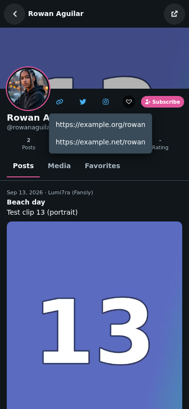
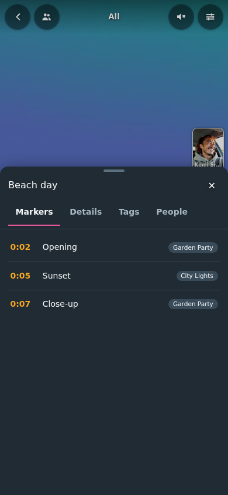
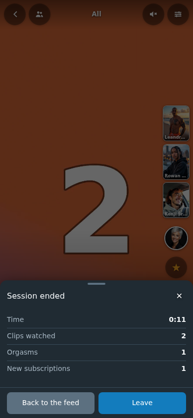
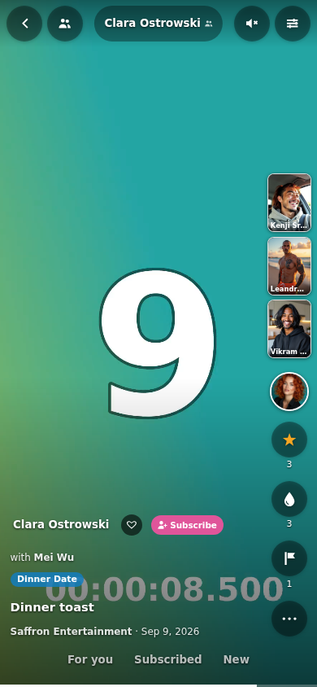
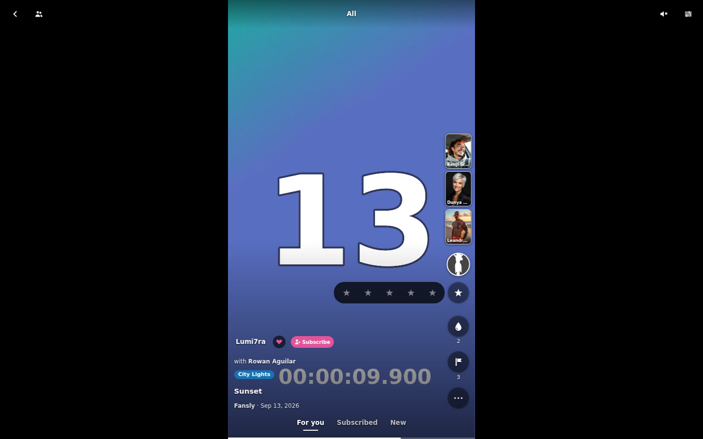
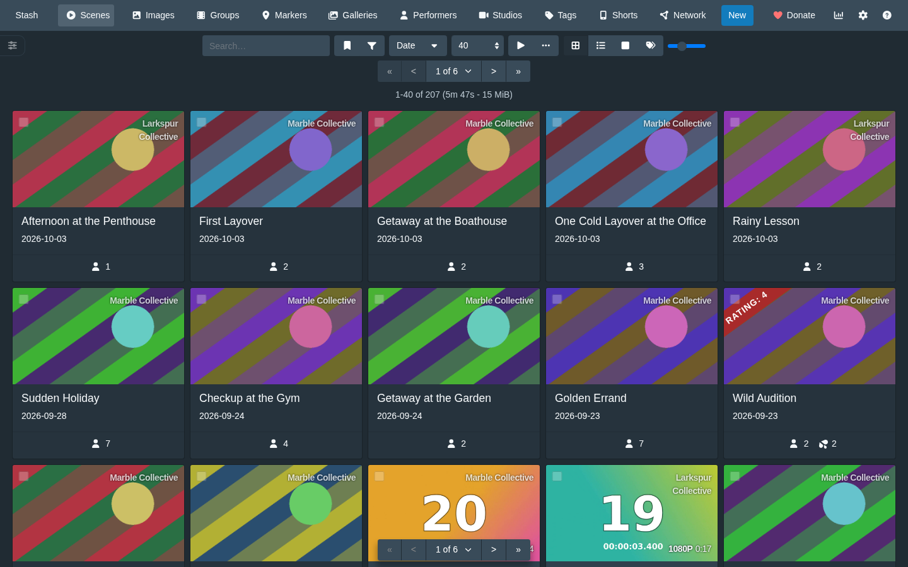

# How the feed works

## Which scenes

The feed asks Stash's GraphQL API for scenes in portrait format (`orientation: PORTRAIT`), 20 at a time,
with the filters from the settings or the URL (see [settings.md](settings.md)). The next page is loaded
when five scenes are left. "Random" uses Stash's seeded random order, so the order stays the same while
paging and changes with each visit. Scenes without a video file have no orientation and never show up;
landscape and square scenes neither, unless the setting "Also landscape scenes" is on (see
[settings.md](settings.md)).

## For you

The default order is computed in the browser; nothing about it leaves Stash. When the feed opens, two
queries load light lists: the scenes in the filter (the pool: rating, orgasm count, plays, performers with
their favorite flag, tags) and the whole library with the same numbers, for the taste. Each scene of the
pool gets a score from these parts (the weights are `FOR_YOU` in `stash-shorts-core.js`):

| Part | Weight | Value |
|---|---|---|
| Rating | 1.2 | the scene's stars, 5 stars = 1 |
| Orgasm count | 0.8 | 3 or more = 1 |
| Favorite | 0.8 | a favorite performer in the scene |
| Performer taste | 1.0 | taste for the scene's best liked performer |
| Tag taste | 0.6 | taste for the scene's tags, on average |
| New | 0.7 | never played |
| Seen | minus 0.6 | 10 plays or more = all of it, fewer plays a share |
| Random | 0.6 | new on each visit (and each channel) |

Taste: every scene of the library is liked 0 to 1 (half its rating, a third its orgasm count, a little its
plays). A performer's or tag's taste is the average of their scenes, pulled towards the library's average
when they have few scenes, and scaled so that the best liked is 1. Then the list is walked from the top:
the next scene is the best one within the next 30 that shares no performer with the one before; only when
there is none, a performer comes twice in a row. The pages are then loaded by id in that order.

## Playing

- Videos come from Stash's own stream endpoint (`/scene/<id>/stream`), as the scene page plays them.
  If the browser cannot play a file, the feed tries Stash's transcoded stream (`/scene/<id>/stream.mp4`)
  once and otherwise shows a note on that scene; swiping on works.
  Such a scene starts slower (in the tests 0.7 to 0.9 s instead of under 0.1 s) because Stash transcodes
  it live and the browser cannot load it ahead; it also continues where it was instead of starting over.
- Portrait videos close to the shape of the screen fill it (cropped a little at the edges); others are
  shown whole with dark bars. Landscape and square videos (only with the setting) are shown across the
  full width, centred, with the scene's screenshot blurred above and below.
- Videos start muted (browsers only autoplay muted videos). A tap turns the sound on; the choice is
  remembered for the browser session (`sessionStorage`). Clips loop; with the setting "Next clip at the
  end" the feed moves on to the next clip instead (the last one starts over).
- A double tap on the video adds an orgasm, like the drop button, with a drop and sparks where the finger
  was. So that a double tap does not also toggle the sound, a single tap acts only once 250 ms have
  passed without a second one. Holding still pauses. The setting "Double tap adds an orgasm" turns it off,
  then a tap toggles the sound at once.
- After an orgasm (double tap or drop button), "Orgasm +1" with **Undo** shows for 4 seconds under the
  top bar; Undo takes it back (Stash's `sceneDeleteO`, which removes the newest one). Holding the drop
  button for 0.6 s also takes one back, at any time; the hold that pauses belongs to the video, not to the
  buttons, so the two do not meet.
- A scene starts from the beginning whenever it comes into view by a step up or down (not when a
  performer channel opens with it, see below).
- Only the previous, the current and the next scene have a `<video>` element with a source, so one step in
  either direction plays at once; there are never more than three video elements. When a scene moves
  further away, its element's source is removed (which also ends its download) and the element is reused.
  Slides further away than one step are not in the page.
- Long scenes get no special treatment: the progress bar at the bottom shows the position and jumps there
  when tapped.

## Caption

The bottom left names each thing once, which matters for fan site accounts named after the FansDB
convention (performer "Limon1kaaa", studio "Limon1kaaa (Fansly)"):

- On top the scene's main performer: the name (a tap opens their profile, see below), the heart (Stash's
  favorite) and **Subscribe**. Their picture is the profile button at the top of the action column. The
  main one is the channel's performer in a channel, else the first one subscribed to, else the first
  favorite, else the first. Further performers follow in a line "with Name, Name", each a link to their
  channel.
- The title in one line, unless it is only the name of a performer or of the studio. Without a title
  the file name is shown, but only when nothing else would be. A tap on it unfolds the title and the
  scene's details (with FansDB the post's text) to three lines; another tap folds them again.
- Below it one line with the studio and the date. Only a studio named after a performer of the
  scene is changed: it shows its parent studio when it has one (FansDB: "Limon1kaaa (Fansly)" belongs to
  "Fansly", so "Limon1kaaa · Fansly"); without a parent, the rest of its name ("Limon1kaaa Fansly" also
  gives "Fansly"); when it is just the performer's name, it is left out. Every other studio keeps its
  full name. Names are compared without case, accents and punctuation; the performer's name has to be a
  whole word in the studio's name ("Anna" does not change "Annabelle Studios"). The studio link always
  leads to the scene's own studio.
- The studio is shortened by the performers of the scene, also in a channel.

## Action column and More

On the right, from the top (below the side previews): the profile button, the rating (a star with the
number of stars; a tap opens five stars), the orgasm counter (the drop, with Undo, see below), the markers
of the scene with their number (opens the detail sheet at its markers) and **More** (three dots).

- The **profile button** is the main performer's picture: a tap opens their profile. Subscribing is the
  Subscribe in the caption (a small pill in a full 44 px target) and in the profile.
- **Share** (in More) gives the address of the scene in the feed, `/shorts?scene=<id>` (see
  [settings.md](settings.md#url-parameters)). On a phone the system's share sheet opens; elsewhere the
  link goes to the clipboard ("Link copied"). Browsers allow the clipboard only on HTTPS or localhost; a
  Stash on plain HTTP in the home network gets a small sheet with the link selected, to copy by hand.
- **More** is a sheet with: Details, open the scene in Stash (at the current position), the profile and the
  Stash page of each performer, Share, and the filters and settings.

## Creator profile

A performer's page in the look of a creator app, over the feed (`/shorts?profile=<id>`, its own history
entry: the browser's back closes it at the same scene, the button at the top left too). It opens from the
name in the caption, from More and from the name at the top in a channel.

- Head: a banner (the screenshot of their best rated scene in the feed's format, darkened), the round
  avatar, their links, the heart and Subscribe, the name and a handle made of it ("@limon1kaaa"; with the
  disambiguation after it), the bio from Stash's details (three lines, a tap shows all), and four numbers: posts (scenes in the feed's format and galleries), media (those scenes and the pictures of
  their galleries), likes (their orgasm count) and the rating in stars.
- Links: as on Stash's performer page, one button per group (all links; twitter or x.com; instagram), each
  with its icon (Stash's own FontAwesome icons) and a menu of the addresses, which open in a new tab. The
  buttons have Stash's classes, so they look like the rest of Stash; the menu opens to the right of its
  button, or to the left where the screen ends, and closes with a tap outside it, a link or Esc.
- **Posts**: scenes and galleries in one list, newest first by date (those without a date at the end),
  each with date and studio, title, text (three lines, a tap shows all), the picture (the animated preview
  where Stash generated one, else the screenshot) with the duration or the number of pictures, and stars,
  orgasms and markers.
- **Media**: a grid of the scenes and the gallery pictures, newest first. **Favorites**: their scenes with
  4 stars or more, or with orgasms, best rated first.
- The lists load 20 at a time as they scroll into view; the two sources of a list are merged page by
  page, so the order holds across pages. There is no video element in the profile.
- A tap on a scene plays it in the performer's channel, starting with it; back from there returns to the
  feed. A gallery or picture opens as a gallery post there (see below), at that picture.
- The button at the top right opens the performer's page in Stash.

## Detail sheet

A sheet from the bottom over the lower part of the screen, while the video goes on above it. It opens
from the marker count, from "Details" in More, and from the unfolded caption. It loads the scene once per
visit (one `findScene`) and has four tabs:

- **Markers**: time, title and primary tag, in order. A tap closes the sheet and jumps there: the scene
  seeks to the marker's time. In a marker clip, a tap on another marker turns the clip into the whole
  scene from that time, in the same place of the feed (the progress bar then shows the whole scene); a
  step away and back starts it there again.
- **Details**: date, studio, code, director, the full text and the scene's links (they open in a new tab).
- **Tags**: a tap shows all scenes with that tag (the address gets `?tag=`), like the filter in the dialog.
- **People**: each performer with the name (their profile), favorite heart and Subscribe.

## Session summary

Leaving the page by its back button (or Esc) first shows a sheet "Session ended" with what the visit did:
the time on the page, the clips watched (entries shown for 3 s or longer), galleries seen, orgasms added
(minus those taken back) and new subscriptions. "Back to the feed" closes it, "Leave" leaves; the next
back shows it again, up to date. In the home screen app it takes the place of the hint "Go back again to
leave": the back gesture shows the summary once, Leave or the next back closes the app. Nothing of it goes
to Stash; the last ten visits are kept in the browser (`localStorage`) and listed under "Recent sessions"
in More, also visits left another way (a link in Stash, closing the tab), which get no sheet. A visit that
watched and did nothing shows no sheet. The setting "Summary when leaving" turns it off.

## Side previews

Above the buttons on the right, up to three tiles with related performers, picture and name; a tap opens
their channel. Related means: they appear in scenes together with the scene's performers (counted over
the whole library), then they have scenes in the scene's studio; favorites first, then by how often;
never a performer of the scene, and only performers with scenes in the feed's format, so a tile never
leads to an empty channel. It is computed in the browser from the light list of the library that "For
you" loads anyway, once per visit. The tiles are pictures, no video. On a screen lower than 800 px there
are two, lower than 700 px none; they also go while the stories bar is open. The setting "Side previews"
turns them off.

## Quick actions

With the setting "Quick actions" (off by default, because the row covers a little more of the video) a row
above the caption holds one-tap actions: five stars (the same rating as the star in the column, which
shows it at once), the drop (the column's orgasm button, with Undo and splash), and up to five tags of
one's own choice ("Quick tags" in the dialog). A quick tag is a toggle on the scene: Stash's `sceneUpdate`
gets the scene's whole tag list with it added or taken out, so the other tags stay. On a gallery entry
there are no quick tags. The row scrolls sideways when it does not fit.

## Subscriptions

**Subscribe** follows a performer in Shorts without making them a favorite in Stash: it is stored in a
custom field of the performer, `shorts_subscribed` (`"1"`), written with Stash's `partial` update so
other custom fields stay, and removed again on the second tap. It shows on the performer's page in
Stash under the custom fields and is the same on every device. The subscribed performers are loaded once
when the page opens (one `findPerformers` with the custom field criterion). The heart stays Stash's
favorite.

## Splash

Adding an orgasm (drop button or double tap) sends eight white drops up over the video; from the drop
button at the right edge they drift to the left. At most one splash runs per button, so fast tapping
does not pile them up, and they are gone after 1.3 s. The setting "Splash on an orgasm" turns them off;
"Splash also when subscribing" adds them to Subscribe. With the system's reduced motion setting there is
only one drop that fades.

## Performer channel

Vertical goes to the next scene, sideways changes what the feed shows:

- **Swipe to the left** (desktop: drag to the left or the right arrow key) opens the channel of a performer
  of the current scene: only their portrait scenes, starting with the current one, which keeps playing.
  With several performers, favorites come first, otherwise the first one; another swipe to the left goes
  to the next performer of the scene shown. A tap on a name after "with", on a side preview or on an
  avatar of the stories bar opens that performer's channel; their profile has the channel too.
- **Swipe to the right** (left arrow key, or the browser's back button) goes back to the previous context,
  at the scene where you left it. A channel opened from a link goes back to all scenes.
- The label at the top shows "All" (or "Filtered" with filters) or the performer's name; in a channel a tap
  on the name opens their profile (the link is their page in Stash, for a new tab or the browser's menu on
  a long press).
- The address shows the channel (`/shorts?performer=12`), so it can be bookmarked; the back and forward
  buttons move through the channels like the swipes.
- In a channel only the order of the feed's filters applies; tags, studios, rating and favorites do not.
  When the performer has no other portrait scene, a short hint says so and the channel opens anyway.
- The direction of a drag is decided after the first 10 pixels: up to 25 degrees from the horizontal it
  is sideways, anything steeper is vertical, so an oblique swipe never changes the channel. Applying
  filters in the dialog returns to all scenes.
- On a change of context the other videos lose their source; the limit of three video elements stays.

## Scene markers as clips

With the setting "Scene markers as clips" (on by default) every scene marker of the scenes in the filter
(and so in the feed's format) is an entry of its own. It plays the scene's stream from the marker's time
up to its end, or 30 s when it has none (never past the end of the file), and then starts again at the
marker, or goes on to the next clip with "Next clip at the end". The progress bar shows the marker's part.
The title is the marker's title (or its primary tag), the primary tag is a chip above it. Rating, orgasm
counter, favorite and "open the scene" act on the scene; a play is counted once per scene and visit,
also when the scene and its markers are both shown.

Where markers go: right after their scene for "newest by date", "newest" and "most viewed", at random places for "random",
and for "For you" scored like their scene, so they do not come right next to it. With markers the ids of
the feed are loaded once (one query for the markers, one for the scenes' ids) and the pages by id.

A marker entry uses one of the same three video elements as a scene. Not covered yet: a marker of a scene
the browser cannot play directly starts at the beginning of Stash's live transcoded stream, and the feed
does not continue at a marker (only at a scene).

## Modes

A bar at the bottom, above the progress bar, switches what the feed shows; caption and action column sit
above it. A tap shows all scenes in that mode (also from inside a channel), with the stored filters:

- **For you**: the "For you" order (the default).
- **Subscribed**: scenes with a performer subscribed to (see Subscriptions), newest first by date, like a
  timeline. With nobody subscribed the feed says how to subscribe.
- **New**: scenes not watched yet (play count 0), newest first by date.

Each mode is a filter, so the address carries it (`?subs=1&order=date`, `?unseen=1&order=date`) and the
filter dialog shows it; a filter that is none of the modes underlines none. In a channel no mode is
underlined. A mode replaces the address like Apply in the dialog: the browser's back does not return to
the mode before. The bar fades out with the rest of the overlay (phone sideways).

## Galleries as posts

With the setting "Galleries as posts" (on by default) every gallery in the filter is an entry of the feed
of its own: one picture at a time, the count at the top ("3 / 24"), the caption as for a scene (main
performer with Subscribe, title, text, studio and date).

- Which: galleries with at least one picture in the feed's format (portrait, or all with "Also landscape
  scenes") and the feed's tags, studios, performers, favorites and minimum rating. With "Only unwatched
  scenes" there are none (a gallery has no play count). In a performer's channel, their galleries.
- Where: one after every few entries (at least every 4, spread over the whole feed), the best rated
  first with a random share for "For you", the newest first for "newest", else at random.
- A sideways swipe flips the pictures (the arrow keys too); past the last picture a swipe to the left
  opens the channel as on a video, before the first one a swipe to the right goes back. Up and down are
  the next and previous entry.
- Only the picture shown and its two neighbours have a source, and a gallery entry has no video element.
  A picture close to the shape of the screen fills it, as a video does.
- The star rates the gallery (`galleryUpdate`); the drop counts an orgasm on the picture shown (Stash keeps
  it per picture, `imageIncrementO`, Undo with `imageDecrementO`); Share gives `/shorts?gallery=<id>`;
  More opens the gallery in Stash.
- With "Next clip at the end" each picture stays for the seconds set in "Seconds per picture" (4 by
  default) and after the last one the next entry follows.
- In the creator profile a gallery post (or a picture of the Media grid) opens it in the performer's
  channel, at that picture.

## Continuing where you were

The feed remembers the scene last shown in each context: all scenes with a set of filters, or a
performer's channel (in the browser's `localStorage`, for 14 days, at most 30 contexts). Opening the page
in that context again starts with that scene and says "Continuing where you were" for a few seconds,
with "Start over" next to it; the scenes after it follow in the feed's order. Only scenes that still fit
the context's filter are taken (one query with Stash's `id` criterion). Without `localStorage` (private
mode, blocked) the feed works the same, it just does not remember.

"Only unwatched scenes" (play count 0) is a filter like the others. Because a scene played in
the feed drops out of that filter, the ids are loaded once in the feed's order and the pages by id, so no
scene is skipped (as for "For you").

## Turning the phone

Only with the setting "Also landscape scenes", and only on touch screens (a desktop window is landscape
as well, nothing changes there):

- Phone held sideways, landscape clip: the clip takes the whole screen, shown whole (`contain`: full
  height on a phone, so narrow bars left and right for 16:9), without the blurred picture. The top bar,
  caption, action column and performer bar fade out after 2.5 s without a touch; a tap brings them back
  (that tap does not toggle the sound). Swipes stay the same: up and down for the next clip, sideways for
  the channel.
- Phone held sideways, portrait clip: the clip in a column in the middle at full height, as on a desktop.
- Phone held upright, landscape clip: a quiet "Rotate" button below the video. Where the browser allows
  it (Android Chrome), it switches to full screen and locks the screen to landscape; the lock and full
  screen end with the next portrait clip or when the page is left. Elsewhere (iOS Safari has neither) it
  says to turn the phone.
- Turning keeps the video elements, so the clip goes on where it was, with the same sound.

## Performer bar

The button with two people next to the back button opens a row of round avatars under the top bar, like
stories: only performers with scenes in the feed's format, favorites first (with a pink ring), then by
number of those scenes (at most 40). It scrolls sideways; a tap opens the performer's channel. The bar
closes again with the button, Esc, the next step or a change of context, so it never stays over the
video. The numbers come from the same query as the suggestions in the filter dialog.

## What is written to Stash

| Action | GraphQL | When |
|---|---|---|
| Count as watched | `sceneAddPlay` | once per scene and visit of the page, after 5 s of actual playback (setting); seeking and the loop starting over do not count as playback |
| Orgasm counter | `sceneAddO` | the drop button, +1 per tap, like the button in Stash's player |
| Rating | `sceneUpdate` (`rating100`) | the star button opens five stars; whole stars (20 per star), the same star again clears the rating, as in Stash |
| Quick tag | `sceneUpdate` (`tag_ids`, the whole list with one tag added or taken out) | a quick tag in the row above the caption (setting) |
| Gallery rating | `galleryUpdate` (`rating100`) | the star button on a gallery entry |
| Picture orgasm counter | `imageIncrementO`, `imageDecrementO` (Undo) | the drop button or double tap on a gallery entry, on the picture shown |
| Favorite | `performerUpdate` (`favorite`) | the heart next to the performer's name |
| Subscription | `performerUpdate` (`custom_fields`: `partial` with `shorts_subscribed`, or `remove`) | Subscribe next to the performer's name, in the caption or the profile; nothing else of the performer changes |
| Settings | `configurePlugin` | Save as default in the dialog |

Read only, for the dialog: the names of all tags, studios and performers, and one `findScenes` over the
scenes in the feed's format with only the ids of their tags, studio and performers, to offer and count
the entries.

Nothing else is changed. "Open the scene" (in More) goes to Stash's scene page at the current position.

## Requests

Everything is loaded from the Stash server the page came from: the plugin files, its texts, GraphQL,
streams, screenshots and performer images. Stash's absolute URLs are turned into paths on the current
origin, which also keeps the feed working behind a reverse proxy. No CDN, no fonts or icons from
elsewhere, no runtime dependencies.

## The page in Stash

The navbar gets a "Shorts" entry; the page covers Stash's whole window, navbar included. The back button
(or Esc) returns to the page before the Shorts page, also from inside a performer channel, after the
session summary (see above).

