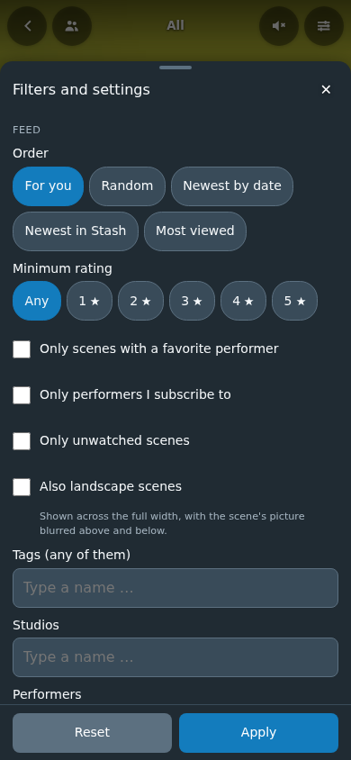

# Settings and URL parameters

The sliders button at the top right of the Shorts page opens the dialog (keyboard accessible, Esc
closes, also with the focus elsewhere). On a phone it is a sheet from the bottom over the full width,
with a grip at the top: dragging its head down by 80 px (or quickly) closes it; every button, choice
and field is at least 44 px high. **Apply** and **Reset** stay at the bottom: Apply changes the feed of this view
only (and writes the URL parameters below into the address, so the view can be bookmarked); Reset sets
the feed's filters back to none (not the playback settings) without closing. **Save as default**, at the
end of the dialog, stores everything in Stash's plugin settings, so it is the same on every device and
also appears in Stash under Settings → Plugins → Stash Shorts.

Order and minimum rating are rows of buttons. Tags, studios and performers are picked by typing: the
list below the field offers only entries that have scenes in the feed's format (portrait, or all formats
with "Also landscape scenes"), with the number of those scenes ("Fansly · 19"), names starting with the
typed text first; performers with their picture. With an empty field it shows the eight with the most
scenes. Chosen entries are chips above the field. The numbers come from one query for the references of
all scenes in the format, counted in the browser, once per format and page visit.

## Settings

| Section | Setting in the dialog | Stash key and type | Default |
|---|---|---|---|
| Feed | Order | `order`, string: `forYou` (see [features.md](features.md#for-you)), `random`, `date` (newest first by the scene's date, with FansDB the post date), `newest` (newest in Stash, by the time a scene was added) or `mostViewed` | `forYou` |
| Feed | Only performers I subscribe to | `subscribedOnly`, boolean (Subscribe in the caption, see [features.md](features.md#subscriptions)) | `false` |
| Feed | Only scenes with a favorite performer | `favoritesOnly`, boolean | `false` |
| Feed | Minimum rating | `minRating`, number 0 to 5 (stars; 0 = any) | `0` |
| Feed | Only unwatched scenes | `unseenOnly`, boolean (play count 0) | `false` |
| Feed | Tags (any of them) | `tags`, string: comma separated tag IDs | none |
| Feed | Studios | `studios`, string: comma separated studio IDs | none |
| Feed | Performers | `performers`, string: comma separated performer IDs | none |
| Feed | Also landscape scenes | `allowLandscape`, boolean | `false` |
| Feed | Scene markers as clips | `disableMarkers`, boolean: `true` = no marker entries | `false` (markers on) |
| Feed | Galleries as posts | `disableGalleries`, boolean: `true` = no gallery entries | `false` (galleries on) |
| Playback | Next clip at the end | `autoAdvance`, boolean: `true` = at the end of a clip the next one follows (the last one starts over) | `false` (clips loop) |
| Playback | Double tap adds an orgasm | `disableDoubleTap`, boolean: `true` = no double tap, a tap toggles the sound at once | `false` (double tap on) |
| Playback | Keep the screen on | `disableWakeLock`, boolean: `true` = the screen dims as usual while a video plays | `false` (screen stays on) |
| Playback | Splash on an orgasm | `disableSplash`, boolean: `true` = no drops rise over the video | `false` (splash on) |
| Playback | Splash also when subscribing | `splashOnSubscribe`, boolean | `false` |
| Playback | Summary when leaving | `disableSummary`, boolean: `true` = the back button leaves at once | `false` (summary on) |
| Playback | Side previews | `disableRelated`, boolean: `true` = no tiles of related performers on the right | `false` (previews on) |
| Playback | Quick actions | `quickActions`, boolean: a row above the caption with rating, orgasm and quick tags | `false` |
| Playback | Quick tags (up to 5) | `quickTags`, string: comma separated tag IDs, picked by name in the dialog | none |
| Playback | Count as watched | `disablePlayCount`, boolean: `true` = do **not** count | `false` (counting on) |
| Playback | Count after seconds of playback | `playCountAfter`, number 1 to 60 (0 = default) | `5` |
| Playback | Seconds per picture with Next clip at the end | `galleryImageSeconds`, number 2 to 15 (0 = default) | `4` |

By default the feed shows portrait scenes only (Stash's orientation filter). With `allowLandscape` it
also shows landscape and square scenes: the video across the full width, centred, with the scene's
screenshot blurred above and below (still one video element per scene). This is a setting only, not a
URL parameter, so a link cannot change it.

Details:

- Why `disablePlayCount` and not `countPlays`: Stash shows a boolean that was never saved as off, so a
  setting whose default is "on" is stored as its negative. The dialog shows the positive wording.
- Invalid or missing values fall back to the default; numbers are clamped to their range.
- Stash's plugin settings are replaced as a whole when saved; the dialog always sends the complete set
  (values equal to the default are left out).
- In the dialog, tags, studios and performers are picked by name; in Stash's own settings page they are
  IDs (the number in the address of the tag, studio or performer page).

## URL parameters

Parameters override the stored settings for one view, for example from a bookmark or a link:

| Parameter | Example | Meaning |
|---|---|---|
| `tag` | `/shorts?tag=3,5` | scenes with any of these tag IDs (`tag=` clears a stored tag filter) |
| `studio` | `/shorts?studio=2` | scenes of these studio IDs |
| `performers` | `/shorts?performers=12,40` | scenes with any of these performer IDs |
| `performer` | `/shorts?performer=12` | the channel of this performer (see [features.md](features.md#performer-channel)); the other parameters do not apply there |
| `fav` | `/shorts?fav=1` | `1` = only scenes with a favorite performer, `0` = all |
| `rating` | `/shorts?rating=4` | minimum rating in stars, 0 to 5 |
| `unseen` | `/shorts?unseen=1` | `1` = only unwatched scenes, `0` = all |
| `subs` | `/shorts?subs=1` | `1` = only performers subscribed to, `0` = all |
| `order` | `/shorts?order=newest` | `forYou`, `random`, `date`, `newest` or `mostViewed` |
| `gallery` | `/shorts?gallery=7` | starts with this gallery, like `scene` |
| `profile` | `/shorts?profile=12` | opens the creator profile of this performer over the feed; back closes it |
| `scene` | `/shorts?scene=115` | starts with this scene, whatever the filters and the format; the feed of the context follows. The address drops it once the scene is shown. An unknown id gives a hint and the usual feed |

Unknown parameters and invalid values are ignored.
